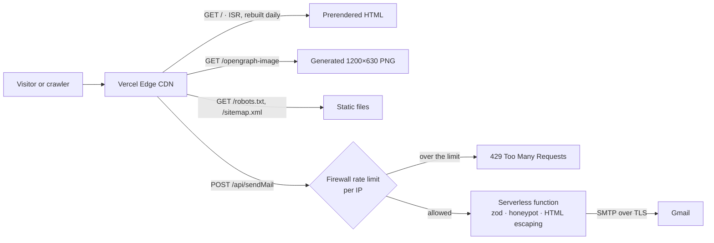

# Srinithin Thangadurai — Portfolio

Personal portfolio of a full-stack developer, built with Next.js 16 (App Router), React 19 and Tailwind CSS 4.

**Live:** https://srinithin-portfolio.vercel.app

The page itself is simple. This README documents the engineering behind it: how it is rendered, how the contact form is protected, and what was measured and fixed.

## Architecture



- **Every page is static.** `next build` prerenders the HTML; Vercel serves it from the edge. No server code runs when someone views the page.
- **The only dynamic route is the contact form API.** It is rate-limited at the edge by a Vercel Firewall rule, so blocked requests never reach the function or Gmail.

## Key decisions

| Decision | Why |
| --- | --- |
| Page is a **Server Component**; only the navbar, scroll observer and form are client components | Static sections ship no JavaScript and never re-render on scroll. Client JS dropped from 526 kB to 486 kB (uncompressed). |
| **ISR** (`revalidate = 86400`) on the page and OG image | Years of experience are calculated from the career start date at render time; the page refreshes daily without a redeploy. |
| Time-dependent values computed **inside components**, not at module level | Module code runs once per server process; ISR re-runs components, not modules. |
| **Server-side validation** with zod, even though the form validates too | Client validation is UX. Anyone can call the API with curl. |
| **HTML escaping per value** in the email template | User input is inserted into HTML; escaping the template instead of the values would leave injection open. |
| **Honeypot** field returning a fake 200 | Catches bots that fill every field, without telling them they were caught. |
| **Rate limiting at the edge** (Vercel Firewall), not in app code | Serverless instances share no memory, so an in-memory counter doesn't work. The firewall counts before the function runs. |
| Errors logged on the server, generic message to the client | Nodemailer errors contain SMTP details that shouldn't leave the server. |
| `SITE_URL` defined once in `app/lib/profile.js` | Canonical URL, sitemap, robots and OG image all depend on it. |

## SEO

- `metadata` in `app/layout.tsx`: title template, description, canonical, Open Graph, Search Console verification
- `app/robots.ts` and `app/sitemap.ts` (Next.js file conventions)
- `app/opengraph-image.tsx`: preview card generated at build time with the Geist fonts in `assets/fonts`
- JSON-LD `ProfilePage` + `Person` in `app/page.tsx`, validated with Google's Rich Results Test
- Verified in Google Search Console

## Performance

Measured on a production build (`npm run build && npm start`), cache disabled, no scrolling.

| Change | Before | After |
| --- | --- | --- |
| Favicon resized from 1254×1254 to 96×96 | 937 kB (75% of the page) | 5.9 kB |
| Total transferred on first load | ~1.24 MB | ~0.3 MB |
| Page as Server Component (JS files) | 11 | 9 |
| JS transferred / parsed | 162 kB / 526 kB | 149 kB / 486 kB |
| Unused dependencies and `public/` files | 6 packages, 31 files | 0 |

The biggest win was found by sorting the Network panel by size, not by guessing.

## Project structure

```
app/
├─ page.tsx                 # Home (Server Component) + JSON-LD
├─ layout.tsx               # Metadata, fonts, navbar, analytics
├─ opengraph-image.tsx      # Generated preview image
├─ robots.ts, sitemap.ts
├─ api/sendMail/route.js    # Contact form API
├─ components/
│  ├─ essential/            # Page sections
│  ├─ SectionObserver.jsx   # Client: highlights the active nav item
│  └─ FormSubmission.jsx    # Client: contact form
├─ context/                 # Active-section context
└─ lib/                     # profile data, zod schema, HTML escaping
assets/                     # Build-time inputs for the OG image (fonts, photo)
public/                     # Static files served as-is
```

## Running locally

Requires Node.js 22.

```bash
npm install
cp .env.example .env   # then fill in the values
npm run dev
```

| Variable | Purpose |
| --- | --- |
| `SMTP_USER` | Gmail address the contact form sends from and to |
| `SMTP_PASSWORD` | Gmail app password (not the account password) |

Scripts: `npm run dev`, `npm run build`, `npm start`, `npm run lint`.

## CI

GitHub Actions (`.github/workflows/ci.yml`) runs `npm ci`, `npm run lint` and `npm run build` on every pull request and push to `main`.

## Next

- A `/learn` section of technical articles (MDX, statically generated, per-article metadata and JSON-LD)
- Custom domain
